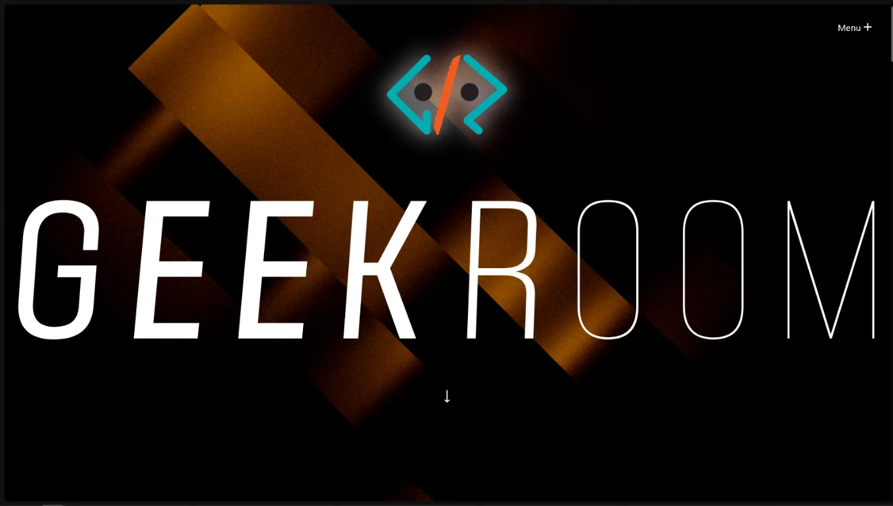

> **Disclaimer:** Due to my Windows installation getting corrupted after an update, my original files have been lost. My GitHub only has the production package, not the development build, so the website may not function correctly if you check it. (2nd August 2026)

## The Beginning

Making any website requires an understanding of both function and design to allow users to understand, use, and connect with it and its purpose.

This will be more of a journey about how to—and how not to—create a website: the reason behind certain decisions, the story behind the final result, the mistakes, and the things learnt along the way.

### “Quick Dev” and “Hard Way”?

Before starting this, my experience with web development only extended to HTML and CSS, with some brief work in JS and PHP on one of my previous projects.

When it came to making this website, it needed to be simple yet impactful. With a short timeline, I couldn't just sit down, allocate time to learning React, and then make the site. I had to learn it on the fly as I was making the site. That’s why “Quick Dev” refers to quickly learning the basic developer workflow for a framework.

“Hard Way,” on the other hand, refers to the mistakes I made along the way. There were a lot, mostly rooted in oversight, which resulted in reworking and fixing things. But if there’s one thing I learnt along the way, it is:

> “It's better to check the best method than to believe you can handle it later.”

You will soon find out why.

## The Basics

### React


React is a free and open-source front-end JavaScript library that aims to make building user interfaces based on components more seamless. It is maintained by Meta and a community of individual developers and companies.

— From Wikipedia

React basically allows you to use what they call “components” directly in your project, which usually resides in `App.jsx`. What JSX is, and the file structure of React applications, will be touched on later. For now, we need to understand the basics.

Ideally, when you use basic HTML, CSS, and JS, you keep the structure in HTML, the style in CSS, and the functioning in JS.

Here it's a little different. You have an `App.jsx` where you make your web page and call components to be used. Your `App.jsx` has its own `index.css`, and the components exist as their own `.jsx` files and may or may not have their own `.css` files.

This allows developers to use components created by other developers with ease, allowing you to focus more on creating the web page rather than creating the components from scratch.

Let's take a small example.

The article demonstrates importing a `LightRays` component from `@/components/LightRays`, placing it inside the app's returned JSX, and configuring its properties (such as the ray origin, colour, speed, length, and mouse-follow behaviour).


As you can see, the `App.jsx` calls a component named `LightRays` that exists in the `/components/LightRays` folder. We then make a `div` in the return for the `App()` function and use the `LightRays` component in the same manner as an HTML element, with its modifiable values.

This is what makes React a great way to implement beautiful, functional components with ease onto our web page.

As for where I got the component, that's where React Bits comes into the picture.

### React Bits

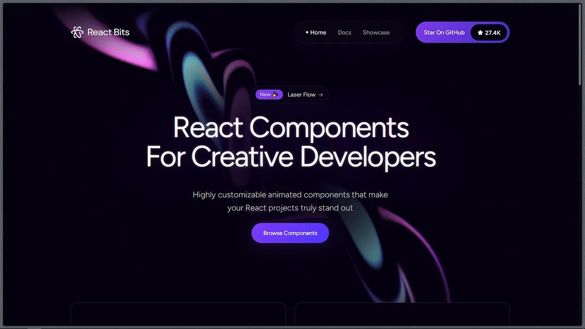

React Bits allows you to use modern, highly customisable components with easy implementation. It is 100% free and open source, allowing you to make edits to the components with ease.

Nearly all of the components I used for this project came from here, and I can say it is a component library I had a ton of fun using.

It consists of everything from text effects, animations, and navigation components to backgrounds and much more.

The components can be installed via the command line or manually, and all the steps are available on the pages for each component.

There's one more thing: hosting the website online.

### Vercel

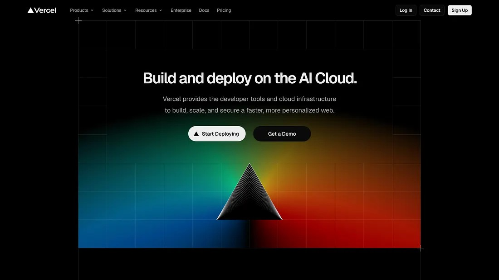

To deploy the site online, I used Vercel. It allows users to deploy sites by giving Vercel access to the GitHub repository that contains the build of your webpage. More on deployment later.

## The Beginning

I will try finishing the website as soon as possible.

*September 17, 2025*

For some context, we needed to make the students of our college aware of the upcoming orientation event of our club.

For it, we needed a site, and I, as the Vice-President, decided to take the initiative so that I could learn and create a site that I could deploy online via Vercel.

As for why a site and not a simple brochure: it has become a standard that every club must have a website. Because of this, I concluded that a website is a necessary requirement for our club, which can be extended in the future.

So here was the game plan:

- Make the webpage using React.
- Publish it using Vercel.

So yeah, let's see how to do that.

## The Prerequisites

### A Code Editor

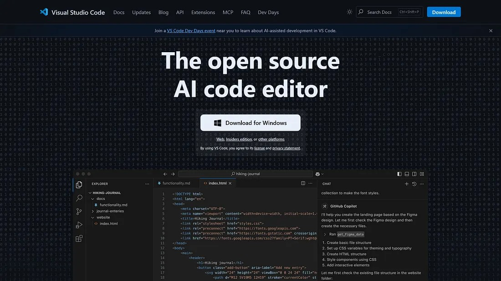

You can use any code editor of your choice. I used Visual Studio Code, however, you can definitely use other tools like Notepad++ (I also see you Vim users—dare I say I love it too).

### Node.js

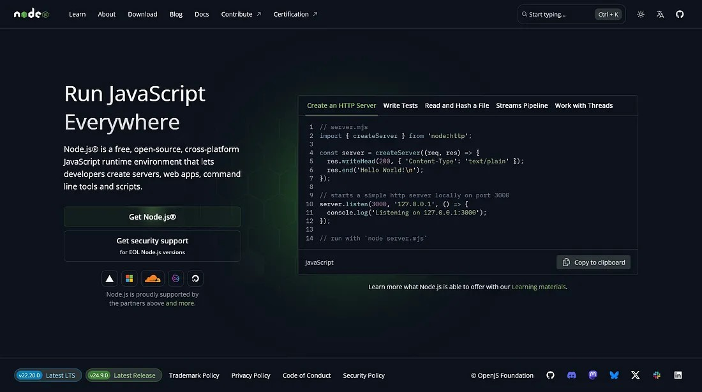

I used Node.js in my project. It comes with npm, a package manager that allows us to manage libraries and modules, which will also allow us to install and use the React library.

It also comes with Vite, a compiler and bundler that allows us to create development servers and create builds of our website that are lightweight and can be used across the web.

## The Process

First thing I had to do was install Node.js. One heads-up I would like to give is that you should note down the location where you are installing it, because you will have to add that directory to PATH on Windows. This process will be different on other operating systems, but the idea is the same.

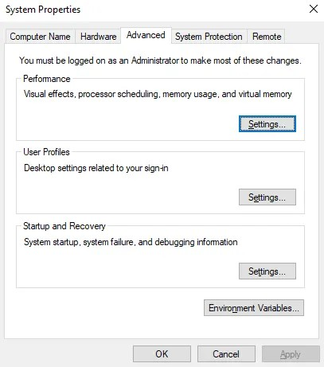

Okay, let's see how we can create a React application.

First make a folder on your PC for the website to live in, then on the command line in the same directory, use either of the following commands:

```bash
npm create vite@latest
```

or

```bash
npm create vite@latest <app name>
```

The `<app name>` just allows you to quickly mention your application folder name; otherwise, it will ask anyway.

The command launches the Vite project setup. It will guide you to select the framework we need: React.

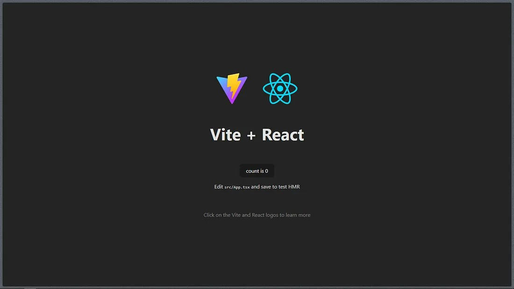

For the variant, we will select TypeScript, as React Bits requires it.

The setup also asks whether to use `rolldown-vite` (experimental). It is not needed here. You can choose to install with npm and start now, which lets you immediately run a development server.

The terminal should show Vite running, with a local address such as `http://localhost:5173`. If you follow the localhost link, it will show the default Vite + React webpage.

Yay! Our webpage with Vite and React!

Just to make sure everything is there, make sure you are in the folder of your created website and run:

```bash
npm i
```

or

```bash
npm install
```

This will install any necessary packages that may not have been installed.

## The Project Structure

Let's clear the things that you should and shouldn't do. Let's see the file structure right now.

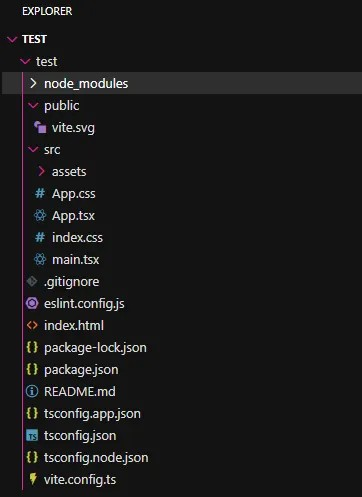

There's a lot to unpack here, so let's just highlight the main files we would be working with.

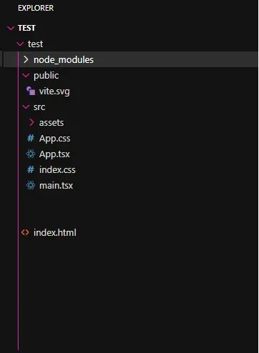

These are the main files we will be working with, whereas the other files are a one-time setup.

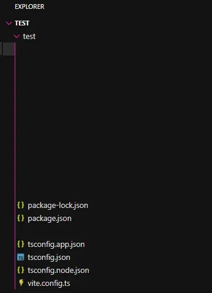

Our goal is to have a directory structure like the one below:

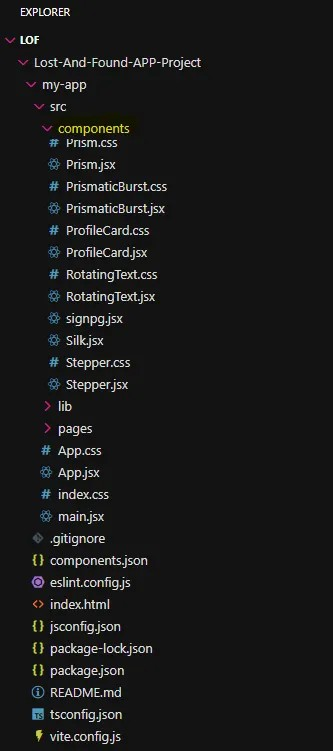

As we can see, it's a clean directory structure with components existing in their own folder, and the main page separated (the `pages` folder exists as this is a multi-page site).

Our objective is to avoid the mistakes below:

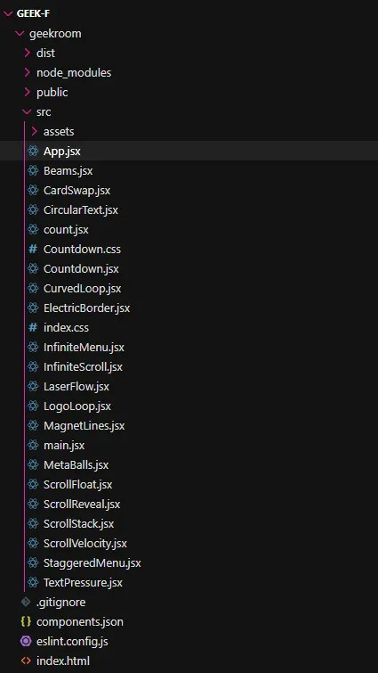

See the problem? No `components` folder, `tsconfig.json` missing, and most importantly, one `.css` file with the CSS of all the components and the main page existing together.

Let's see how to avoid these mistakes by seeing how we can use React Bits components in our project while avoiding common mistakes.

## Using Components

Just to be clear, there are many component libraries online, but we will constrain ourselves to React Bits.

Let's say we want to use a React Bits background like the one below.

### Liquid Ether

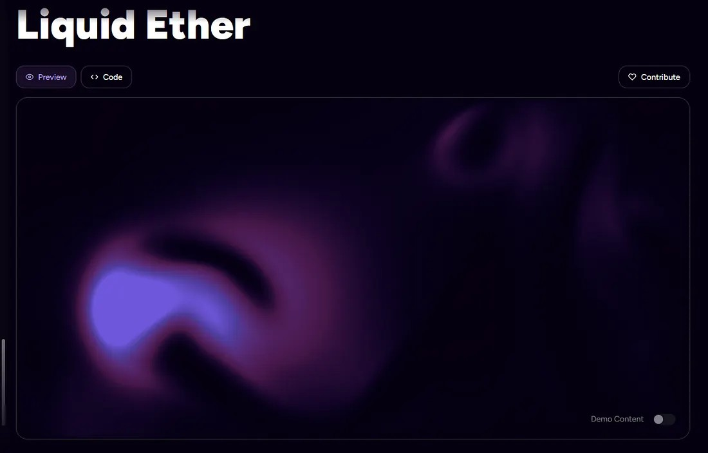

It's a background that reacts to the user's mouse movement and, when not affected, runs a default loop. For my use case, we will first make sure that at the top right of the page we select **JS** and **CSS**.

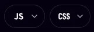

This is because I made the site with React Bits components that use basic `.js` and CSS.

Hey! Why did we select TypeScript earlier?

We used TypeScript because certain components require it. For example, if I remove my `tsconfig.json` file and try installing any component, we will be hit with this:

> No import alias found in your tsconfig.json file. Visit the shadcn installation documentation to learn how to set an import alias.

So make sure to have these files, because while we will be using simple JS and CSS components, we would still need these files.

Now let's see how to use these components.

1. Select **Code**.
2. Copy the code.
3. Select **Install**, and make sure you have selected **CLI** and **npm**.
4. Copy the command and run it in the command line.

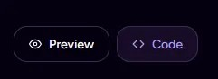

The installation panel provides a CLI command for the selected component:

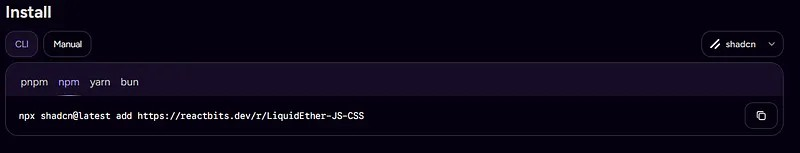

The CLI may ask whether you need to create a `components.json` file to add components. Proceed with **yes**.

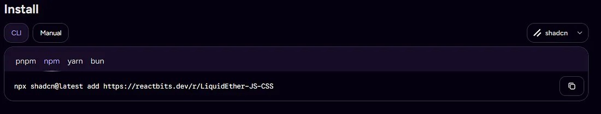

### Fixing the Tailwind CSS and import-alias issues

The installation may report that no Tailwind CSS configuration was found and that no import alias was found in `tsconfig.json`.

On the first line, we said yes because we do need a separate `components.json` for managing component versions. The next block of text says that we don't have Tailwind CSS installed. The last one states that we don't have an import alias in our `tsconfig.json` file.

Let's fix all this, starting with the first block.

#### Tailwind CSS

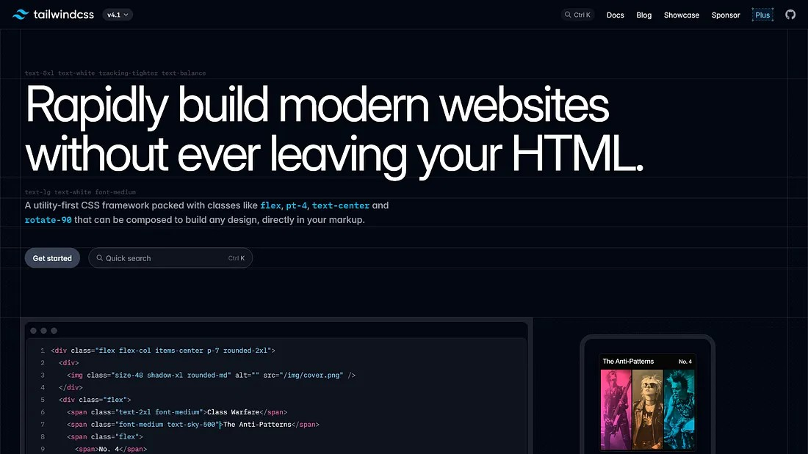

Tailwind CSS is a CSS library that allows you to style elements more quickly by implementing classes directly in your HTML element.

For example, instead of creating a separate CSS class and styling it in a CSS file:

```html
<span class="span1">The Span</span>
```

you can write the styling directly in the class:

```html
<span class="font-medium text-sky-500">The new Span</span>
```

As we can see, the new span now has its styling content in it, and we don't require a separate CSS rule for it, as Tailwind CSS will apply it directly based on what is written in the class.

If you wish, you can use Tailwind in your project. However, we need it because the background elements of React Bits use Tailwind.

To add Tailwind CSS, the article gives this command:

```bash
npm install tailwindcss @tailwindcss/vite
```

After it is done, we will go to `vite.config.js` and add the Tailwind Vite plugin:

```js
import { defineConfig } from 'vite'
import react from '@vitejs/plugin-react'
import tailwindcss from '@tailwindcss/vite'

export default defineConfig({
  plugins: [react(), tailwindcss()],
})
```

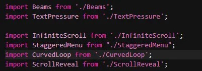

And add this to the top of the `index.css` file:

```css
@import "tailwindcss";
```

#### Fixing the import alias

Now we will solve the second part of this.

To fix the import alias, we will go into our `tsconfig.json`. In it, we will see the project references to:

```json
{
  "files": [],
  "references": [
    { "path": "./tsconfig.app.json" },
    { "path": "./tsconfig.node.json" }
  ]
}
```

To this, we will add `compilerOptions` with a base URL and path alias. The example shown in the article is:

```json
{
  "files": [],
  "references": [
    { "path": "./tsconfig.app.json" },
    { "path": "./tsconfig.node.json" }
  ],
  "compilerOptions": {
    "baseUrl": ".",
    "paths": {
      "@/*": ["./src/*"]
    }
  }
}
```

And that's it. Now when we copy the component's install command and run it, it will create a `components` folder in which the components will be added.

## Using the Component

To use the component in your project, just go to **Usage**.

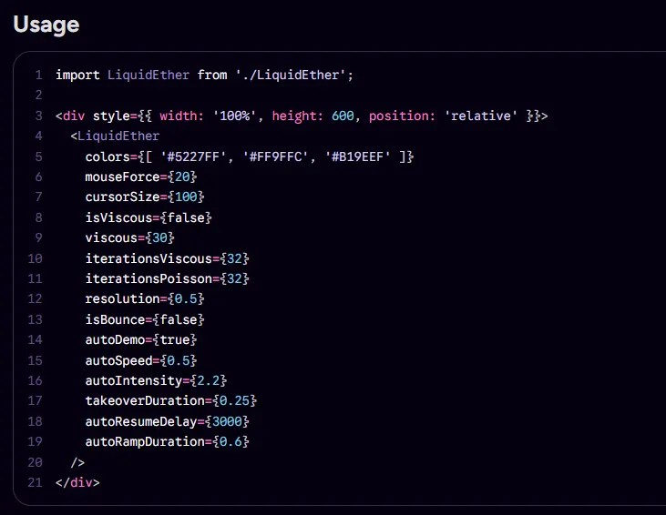

The article also shows an example of keeping component imports together at the top of the app file:


Copy the above and paste it in your file.

It is advised to have all your imports at the very top of your `App.jsx`.

From here, you may now explore ways to make your website as interactive and beautiful as you wish, and learn how divisions work on these components.

To see your project in localhost, run:

```bash
npm run dev
```

## The Final Leg

Now that you have a website, you will need the world to see it.

For that, we will use Vercel.

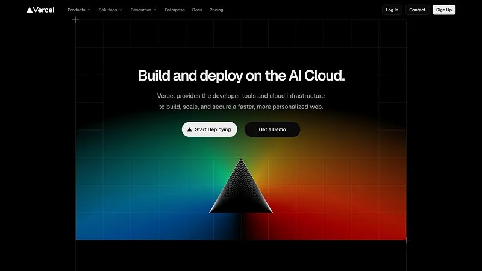

To host on Vercel, we will need it on a public GitHub repository and a Vercel account, so make one. Then on your terminal run:

```bash
npm run build
```

This will make a `dist` folder in which your final build will be made for production. This is the folder you are going to put in your GitHub repository.

### Optional Step

If you want speed insights and an analytics dashboard to work on Vercel for your site, do the following.

In your terminal, run:

```bash
npm install @vercel/analytics
npm install @vercel/speed-insights
```

And in your `App.jsx`, just add:

```jsx
import { SpeedInsights } from "@vercel/speed-insights/react";
import { Analytics } from "@vercel/analytics/react";

<Analytics />
<SpeedInsights />
```

These can be added anywhere in the component's returned JSX.

In your GitHub repository, just add your `dist` folder, go on Vercel, and follow its guide to add the GitHub repository. Voilà! You will have it up and running.

## The Destination: The Website

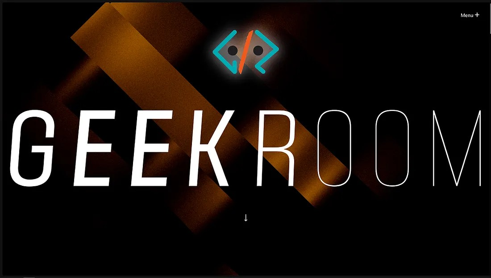

I started with the idea of finishing it in one day; it took me 20 days. It wasn't easy, but it was a great learning experience, and there is still a lot to learn, like Google indexing, which… I'll just say I'm getting there, and you will know once it's done.

Still, just using beautiful components isn't enough to make a website. Planning and research are key in order to create a website.

### What's next?

Well, as of writing this, I have indexed it on Google, meaning my website can be searched for. However, there are more things to be done to make the indexing better, so I am planning on learning more about Google search indexing.

### What We Learned

1. Using React and components.
2. Learned hosting using Vercel.
3. Using components from React Bits.
4. Making correct file structures.

---

